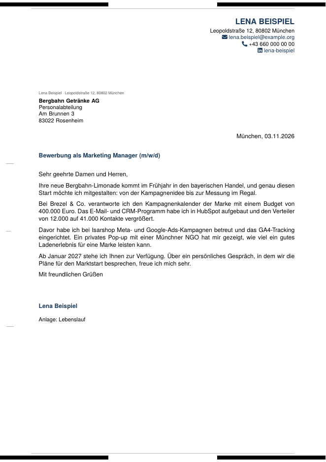
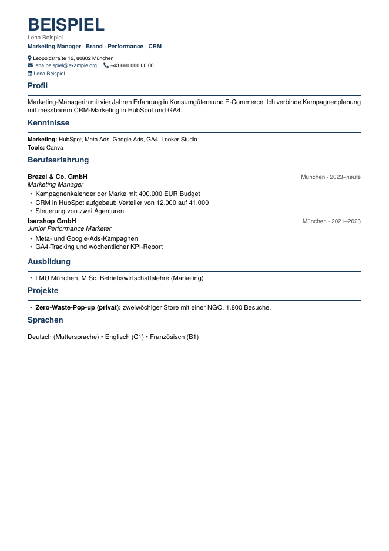
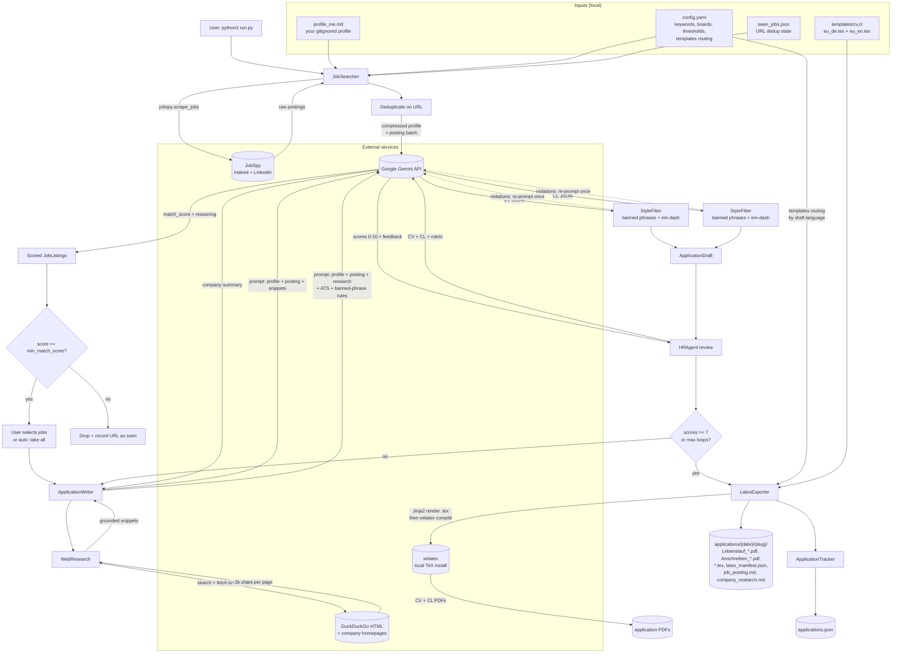
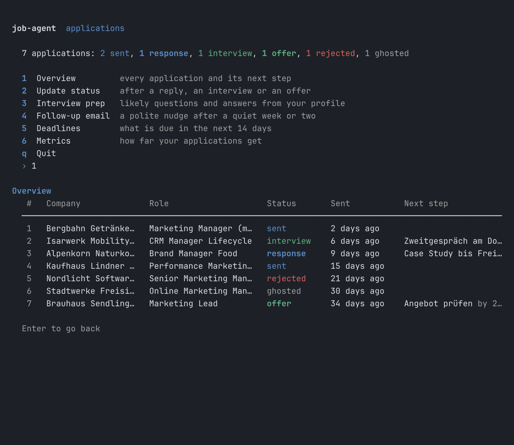
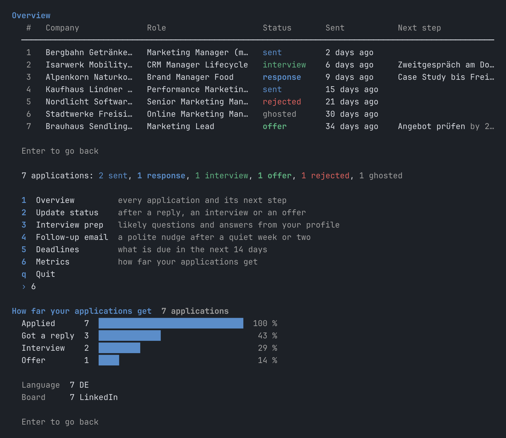

# Job Agent

Automated pipeline that discovers relevant job postings, generates tailored CVs and cover letters, runs them through an HR-quality review loop, and renders finished PDFs locally from LaTeX templates — with language-aware template routing (DE/EN) and a tracker kept up to date.


Each application shows its steps as they complete: company research, CV and letter, the review rounds, the PDFs. What it produces, a DIN 5008 cover letter and a one-page CV (fictional demo data):

<p>
  
  
</p>

**Try it without an API key.** `python scripts/demo/run_demo.py` runs the real interface against simulated job boards and a simulated Gemini, in a throwaway folder (needs `pip install -r requirements.txt` and `xelatex` for the PDFs). `python scripts/demo/run_demo.py tracker` opens the tracker with sample applications.

## Features

- **Multi-platform scraping** — Indeed (country-scoped) and LinkedIn via [JobSpy](https://github.com/speedyapply/JobSpy); URL-based deduplication across runs (`seen_jobs.json`)
- **LLM-driven scoring** — a Gemini model (configurable per task) ranks every posting against a compressed candidate profile across five dimensions (skills, level, industry, location, language), returns a 0-1 match score plus reasoning
- **Grounded company research** — DuckDuckGo HTML search + direct page fetch (httpx + BeautifulSoup) feeds the CL prompt real corporate-site content, so openings are factual rather than hallucinated from model priors
- **Tailored generation** — Per-job CV sections and cover letter with ATS keyword mirroring from the posting, hard word caps tuned to the LaTeX layout, and an anti-AI-tell style filter that deterministically replaces banned phrases and em-dashes
- **HR review loop** — a reviewer calibrated to the candidate's level (from `## Eckdaten`) checks every claim against the profile, scores each draft 0-10, and sends failing drafts back with targeted feedback, up to `max_loops`
- **Local LaTeX render** — `LatexExporter` injects generated text into Jinja2 `.tex` templates (LaTeX-safe delimiters + escaping) and compiles to PDF with `xelatex`; templates are picked per draft language via the `templates` routing in `config.yaml` (DE → `eu_de`, EN → `eu_en`)
- **Application tracker** — Persisted per-job state in `applications.json` (status, deadlines, contacts, CV/CL PDF paths, folder paths)
- **Interactive + auto mode** — pick jobs by hand by default; `--auto` for unattended runs. Nothing is ever sent automatically.
- **Works for any candidate** — everything candidate-specific lives in your profile and `config.yaml`; contact data stays local and never reaches the LLM

## Architecture



**Data flow at a glance.** The pipeline has three boundaries where data crosses into external services: (1) **JobSpy** for raw postings, (2) **DuckDuckGo + company websites** for grounding research, (3) **Gemini API** for scoring, generation, and review. Every generation step includes the candidate profile plus the specific posting; research calls additionally include fetched web content so the model cannot invent facts about the company.

## Project layout

```
job_agent/
├── run.py                      # Main pipeline entry point (--auto for non-interactive)
├── run_tracker.py              # CLI for the application tracker
├── models.py                   # Dataclasses: JobListing, ApplicationDraft, HRReview, TrackedApplication
├── tracker.py                  # ApplicationTracker (persisted in applications.json)
├── profile.example.md          # Profile template (copy to profile_<name>.md, gitignored)
├── config.yaml                 # Search keywords, templates routing, thresholds
├── templates/
│   ├── cv/eu_de.tex            # German CV (Jinja2 + LaTeX)
│   ├── cv/eu_en.tex            # English CV
│   ├── cl/eu_de.tex            # German cover letter (DIN 5008)
│   └── cl/eu_en.tex            # English cover letter
├── assets/                     # your photo.png, signature.png (gitignored, optional)
├── agents/
│   ├── job_searcher.py         # JobSpy scraping + Gemini batch scoring
│   ├── writer.py               # CV + CL generation orchestrator
│   ├── web_research.py         # DuckDuckGo HTML search + page fetch (BS4) for grounding
│   ├── style_filter.py         # Banned-phrase + em-dash detection (single source of truth)
│   ├── hr_agent.py             # Level-calibrated HR reviewer with review loop
│   ├── latex_exporter.py       # Render Jinja2 .tex templates, compile PDF via xelatex
│   ├── latex_utils.py          # Jinja2 env (LaTeX-safe delimiters), escaping, profile parser
│   ├── usage_tracker.py        # Gemini token + cost accounting
│   ├── interview_agent.py      # Interview prep + follow-up emails
│   └── utils.py                # Retry logic for Gemini 429/503 with RPM-aware delay
├── scripts/
│   ├── test_writer_quality.py  # Single-job validation harness (skips discovery)
│   ├── smoke_latex.py          # Render-only smoke test (DE + EN, no Gemini calls)
│   ├── check_layout.py         # Worst-case layout check: page count + DIN 5008 positions
│   └── demo/                   # Demo mode (no API key) + screenshot/GIF recording
├── applications/<date>/<slug>/ # Per-job artifacts
│   ├── Lebenslauf_*.pdf         # Rendered CV
│   ├── Anschreiben_*.pdf        # Rendered cover letter
│   ├── *.tex                    # Rendered LaTeX source (for inspection)
│   ├── latex_manifest.json      # Render manifest (paths, language, timestamp)
│   ├── job_posting.md           # Snapshotted posting for the record
│   ├── company_research.md      # Grounded research summary
│   └── review_v0.json           # HR review per revision (v0, v1, ...)
├── applications.json           # Tracker state (status, deadlines, notes per job)
└── seen_jobs.json              # URL dedup state across runs
```

## Getting started (step by step)

This takes about 30-60 minutes the first time, most of it writing your profile.

### 1. Install the prerequisites

- **Python 3.11+** and **git**.
- **A TeX distribution with `xelatex`** (renders the PDFs locally):
  - macOS: [MacTeX](https://tug.org/mactex/) (full install, ~5 GB).
  - Linux (Debian/Ubuntu):
    ```bash
    sudo apt install texlive-xetex texlive-latex-recommended texlive-latex-extra texlive-fonts-recommended texlive-fonts-extra texlive-lang-german texlive-pictures fonts-texgyre poppler-utils
    ```
  - Windows, or if you don't want a local TeX: use [Docker](#docker-run-on-any-machine)
    instead: you still clone the repo (step 2), but skip installing TeX and the Python packages.
- Check it works: `xelatex --version`.

### 2. Get the code and install the Python packages

```bash
git clone https://github.com/builtbymaxim/job-agent-public.git
cd job-agent-public
python3 -m venv .venv && source .venv/bin/activate   # Windows: .venv\Scripts\activate
pip install -r requirements.txt
```

### 3. Get a Gemini API key

1. Open [Google AI Studio](https://aistudio.google.com/apikey) and sign in with a Google account.
2. Click **Create API key** (it creates a Google Cloud project for you if needed).
3. Create a file `.env` in the repo root (gitignored, never commit it):
   ```
   GEMINI_API_KEY=your-key-here
   ```
4. **Recommended: enable billing** on that Google Cloud project. The free tier allows only
   ~20 requests per day per project, which runs out after 2-3 applications. With billing,
   one application costs well under one cent (5-7 calls). Set a budget alert in Google
   Cloud if you want a hard ceiling.

### 4. Write your profile (the most important step)

```bash
cp profile.example.md profile_me.md   # profile_<anything>.md is gitignored
```

`config.yaml` points at `profile_me.md` by default; change `profile:` if you pick another
name (keep the `profile_` prefix so git ignores it). Everything the tool writes comes
from this file. It never invents experience, so **the more concrete your profile, the
better the applications** (tools, numbers, scope, outcomes).

Keep the `##` headings exactly as in the example. They are parsed by name, even though
they are German. The content can be German or English.

| Section | What to put there | Used for |
|---|---|---|
| `## Kontakt` | `name`, `email`, `phone`, `address` (required, one line: `Street 1, 1010 City`); optional `dob`, `headline`, `github`/`github_url`, `linkedin`/`linkedin_url`, `city`, `city_en` | Letterhead only. Rendered locally, **never sent to the LLM**. |
| `## Eckdaten` | `level`, `target_roles`, `location`, `languages`, `salary`, `availability` as `key: value` | Job scoring, and calibrating the reviewer to your level |
| `## Kurzprofil` | 3-5 sentences: who you are professionally | CV profile, scoring |
| `## Ausbildung` | Degrees, newest first; thesis title if relevant | CV education |
| `## Berufserfahrung` | One `### Company — Role` per job, then `**City \| MM.YYYY–MM.YYYY**`, then `- ` bullets | CV experience: company, role and dates are copied verbatim, only the bullets are tailored |
| `## Projekte & Repositories (Auswahl)` | `### Project name`, stack, what it shows | CV projects, cover letter proof |
| `## Technische Kenntnisse` | `### Category` + skills | CV skills (categories are kept) |
| `## Sprachen`, `## Differenzierungsmerkmale`, `## Interessen & Ausrichtung` … | free text | Tailoring and scoring |

Tips:
- The dateline city (`Wien, 02.11.2026`) is taken from your address. Set `city:` to
  override it, and `city_en:` for English letters (e.g. `city: Wien`, `city_en: Vienna`).
- `dob` is optional; leave it out if you don't want it on the CV.
- Write what is true *today* (`thesis submitted`, not `completed`). The reviewer checks
  every claim against the profile and downgrades anything it cannot trace back to it.

### 5. Optional: photo and signature

```bash
mkdir -p assets
cp ~/path/to/photo.png assets/photo.png           # CV, top right
cp ~/path/to/signature.png assets/signature.png   # cover letter, between closing and name
```

- **Photo:** portrait format (about 4:5 or taller), face in the upper half. It is scaled
  to a 2.6 x 3.0 cm frame and cropped from the bottom.
- **Signature:** PNG with a transparent background, cropped tightly around the
  signature (scan or phone photo, background removed). Rendered at most 13 mm high.
- Both files are gitignored. Without them, the PDFs simply render without photo/signature.

### 6. Adapt `config.yaml` to your search

- `search.keyword_groups`: one entry per search, comma-separated job titles from *your* field.
- `search.location` and `search.country_indeed` (e.g. `München, Germany` / `Germany`).
- `market`: the job market the prompts are written for (`Austrian/European`, `German`, `Swiss`, …).
- `latex.font`: `Helvetica Neue` exists on macOS only. On Linux use `TeX Gyre Heros`
  (or set `JOB_AGENT_FONT="TeX Gyre Heros"`).

### 7. Check the setup (no API calls)

```bash
python3 scripts/smoke_latex.py    # renders sample CV + cover letter (DE + EN) with your profile
python3 scripts/check_layout.py   # worst-case lengths: checks page count and DIN 5008 positions
```

Both should end with `ALL OK`. Open the PDFs that `smoke_latex.py` lists and check your
letterhead.

### 8. First real application

Start with one posting you already know:

```bash
python3 run.py --url "https://…/job-posting"
python3 run.py --paste --url "https://…"   # if the portal blocks scraping: paste the text instead
```

Output lands in `applications/<date>/<company>_<role>/`: `Lebenslauf_*.pdf`,
`Anschreiben_*.pdf`, the `.tex` sources, `job_posting.md`, `company_research.md` and
`hr_review.json`. **Read both PDFs before sending anything.** The tool never sends
applications. To fix a wording, edit the `.tex` and recompile with
`xelatex <file>.tex` in that folder.

Once this works, run the full search with `python3 run.py`, and track your applications
with `python3 run_tracker.py`.

### Troubleshooting

| Symptom | Fix |
|---|---|
| `Profile not found: profile_me.md` | Step 4, or point `profile:` in `config.yaml` at your file |
| `The font "Helvetica Neue" cannot be found` | Set `latex.font: "TeX Gyre Heros"` (step 6) |
| `Daily/project Gemini quota exhausted` | Free tier used up: enable billing (step 3) or wait for the reset |
| `not a job posting` for a URL | The portal blocks scraping: use `--paste` |
| `… runs to 2 pages — shorten it` in the summary | Shorten the text in the `.tex` and recompile |
| `## Kontakt block missing required keys` | `name`, `email`, `phone`, `address` must all be set |

## Docker (run on any machine)

Docker bundles Python, XeLaTeX and a Helvetica-metric font (`TeX Gyre Heros`), so you
don't need a local TeX install. Recommended on **Windows**, and the easiest path on Linux.
Your profile, photo, `.env` and the `applications/` output stay on your machine: the
project folder is mounted into the container at `/app`.

**Prerequisites**
- Windows / macOS: [Docker Desktop](https://www.docker.com/products/docker-desktop/)
  (on Windows with the WSL 2 backend, the installer's default).
- Linux: Docker Engine + the Compose plugin (`docker compose version` must work).
  Files the container writes belong to you, not to root (see `docker/entrypoint.py`).

**Steps** (same commands in PowerShell, Terminal or bash, run from the repo folder)

1. Do steps 3-6 of [Getting started](#getting-started-step-by-step): `.env` with your key,
   your `profile_me.md`, optional photo/signature, `config.yaml`. The `.env` file must
   exist, or Compose refuses to start. You don't need to change `latex.font`, the
   container sets `TeX Gyre Heros` itself.
2. Build the image once (downloads TeX, several GB, 5-15 minutes):
   ```bash
   docker compose build
   ```
3. Check the setup:
   ```bash
   docker compose run --rm job-agent scripts/smoke_latex.py
   docker compose run --rm job-agent scripts/check_layout.py
   ```
4. Run:
   ```bash
   docker compose run --rm job-agent run.py --url "https://…"   # one posting
   docker compose run --rm job-agent run.py --paste             # paste a posting
   docker compose run --rm job-agent                            # full pipeline
   docker compose run --rm job-agent run_tracker.py             # CRM
   ```

The PDFs appear in `applications/` in your repo folder, as with a native install. After
pulling new code, run `docker compose build` again.

**Windows notes**
- Clone the repo into a normal folder (e.g. `C:\Users\you\job-agent`), not into OneDrive,
  which can lock files while Docker writes them.
- Git keeps LF line endings for this repo (`.gitattributes`), so editing files in any
  editor is fine.
- Native Windows without Docker also works with [MiKTeX](https://miktex.org/) or TeX Live
  and Python, but Docker is the recommended path.

## Configuration reference

| Key | Type | Purpose |
|---|---|---|
| `templates.<lang>.cv` | path | CV `.tex` template (relative to `templates/`) for that draft language (`de`, `en`) |
| `templates.<lang>.cl` | path | Cover-letter `.tex` template for that draft language |
| `profile` | path | Markdown profile file (relative to repo root), default `profile_me.md` |
| `market` | string | Job market the prompts are written for, e.g. `Austrian/European`, `German`, `Swiss` |
| `search.platforms` | list | JobSpy boards: `indeed`, `linkedin` (extendable) |
| `search.country_indeed` | string | Country code for Indeed (e.g. `Austria`, `Germany`) |
| `search.keyword_groups` | list | One JobSpy search per entry; each entry is a comma-separated keyword list |
| `search.location` | string | City/region passed to all boards |
| `search.results_wanted` | int | Per-board limit per keyword group (before dedup) |
| `search.hours_old` | int | Posting freshness window |
| `search.max_jobs` | int | Hard cap fed to Gemini for scoring (cost control) |
| `search.min_match_score` | float | Filter threshold (0-1); jobs below this are dropped |
| `output_dir` | path | Where per-application folders are written (relative to repo root) |
| `models.{bulk,writing,review}` | string | Per-task Gemini model; keep `review` different from `writing` |
| `hr_review.{pass_score,max_loops}` | int | HR accept bar (0-10) and max rewrite loops |
| `gemini.rpm_delay` | float | Seconds between API calls |

> **Rate limits:** the Gemini **free tier** caps at ~20 requests/day per *project* (not per key),
> so batches die after 2–3 jobs. Each application is ~5–7 calls and ~$0.002 on paid. **Enable billing**
> (pay-as-you-go) to lift the cap, then set `gemini.rpm_delay` low (~1s) for fast runs. On a rate-limit
> hit the pipeline lets you skip / retry / mark-for-later / abort instead of crashing.

## Usage

### Interactive mode (default)
```bash
python3 run.py
```
You'll be prompted to select jobs from the scored list. Every selected job is generated, reviewed and rendered; the run summary reports HR scores and flags drafts below the pass bar. Review the rendered `.tex`/PDF before sending anything.

Add `--verbose` to any command to see detailed logs (requests, retries, file writes) instead of just warnings.

### Auto mode
```bash
python3 run.py --auto
```
Runs unattended: selects all non-suspicious jobs above the threshold.

### PDF rendering
Rendering is part of the main run — no separate step or external session. On accept, `LatexExporter` picks the CV/CL templates for the draft language from `config.templates`, renders the Jinja2 `.tex` with the generated content, compiles it with `xelatex`, and writes `Lebenslauf_*.pdf` + `Anschreiben_*.pdf` into the application folder alongside a `latex_manifest.json`. A render failure marks the draft `export_failed` and surfaces the tail of the LaTeX log.

To verify the render path independently of Gemini (constructs synthetic DE + EN drafts and compiles all four PDFs):
```bash
python3 scripts/smoke_latex.py
```

### Direct apply
```bash
python3 run.py --url <job_url>           # one posting, no discovery
python3 run.py --paste --url <job_url>   # paste the JD if the portal blocks scraping
```

### Tracker
```bash
python3 run_tracker.py
```
Manage sent applications: update status, interview prep, follow-up emails, deadlines, metrics.

<p>
  
  
</p>

### Recording the screenshots

The images above come from the demo mode and can be regenerated after UI changes
(Linux/macOS; needs Node, Playwright with Chromium, and ffmpeg):

```bash
cd scripts/demo && npm install && cd ../..
python scripts/demo/record.py pipeline /tmp/pipeline.cast       # scripted session -> asciicast
node scripts/demo/render.mjs /tmp/pipeline.cast docs/media/pipeline.gif
node scripts/demo/render.mjs /tmp/pipeline.cast shot.png --at 12  # still frame at 12 s
```

## Design decisions

- **Profile is the source of truth** — Generation prompts explicitly forbid fabricating facts, metrics, or skills. The model can only reorder, emphasize, and reframe what's already in your profile, and the reviewer caps any draft with an untraceable claim.
- **Grounded company research** — Before drafting the CL, the writer scrapes 2-3 real pages about the company (DuckDuckGo + corporate site) and feeds them to Gemini with explicit "do not invent facts" instructions. When the fetch returns nothing, the letter hooks into the posting instead; it never falls back to model priors.
- **Deterministic style enforcement** — `agents/style_filter.py` scans every generated draft for banned AI-tell phrases (`leverage`, `cutting-edge`, `passionate about`, `robust`, ...) and em-dashes and replaces them in place, without another LLM call. Word boundaries prevent false positives ("robustness" ≠ "robust").
- **Word limits match the layout** — Hard caps per section keep generated text inside the fixed LaTeX page geometry (single-page CV, one-page CL) instead of overflowing.
- **ATS keyword mirroring** — Generation mirrors exact terms from the posting ("Power BI" not "data visualization tools", "PostgreSQL" not "relational databases") so ATS parsers extract the right tokens.
- **Local LaTeX, language-routed** — Master `.tex` templates live in the repo; each run renders a fresh copy per application, so there is no shared state to restore. `_pick_templates` resolves CV/CL by draft language and raises a clear error for any unmapped language. DE and EN templates share identical Jinja2 context — only the static LaTeX strings (headings, salutation, hyphenation language) differ.
- **LaTeX-safe templating** — `latex_utils` remaps Jinja2 delimiters (`<< >>`, `<% %>`) so they don't collide with LaTeX braces, and an `e` filter escapes LaTeX specials in all injected text; `bullets`/`inline_bullets` turn writer-style `- item` lines into `itemize` blocks.
- **DIN 5008 cover letter (Form B)** — the letterhead, return-address line, recipient address zone (25 mm from the left, 62.7-90 mm from the top), dateline, subject (98.46 mm), fold marks (105/210 mm) and punch mark (148.5 mm) sit at fixed page coordinates, so they never move with the text length and fit a standard DL/C5 window envelope. The model fills the address block only; the template prints the company above it.
- **One page, no stray breaks** — after compiling, the exporter reads the page count; if a document runs over one page it re-renders with slightly tighter type (cover letter down to 10 pt, the DIN 5008 minimum; CV down to 9.5 pt), and the run summary warns if it still doesn't fit. Paragraphs and list items never split across pages, the closing stays together with the signature and name, and a company heading never sits alone at the bottom of a page. `scripts/check_layout.py` verifies all of this on worst-case input.
- **Free-tier-aware throttling** — `agents/utils.py` enforces an RPM delay before every Gemini call and distinguishes a daily quota (fail fast) from transient rate limits (retry, then skip / retry / mark-for-later).
- **Privacy** — `## Kontakt` (name, address, DOB, email, phone) is rendered into the PDF letterhead locally and stripped from every LLM prompt (`agents/privacy.py`, covered by `tests/test_privacy.py`).

## Status

Early-stage personal tool, used end-to-end for Austrian/German applications. The role archetypes that steer CV emphasis cover data/BI/analytics roles; other fields fall back to the general strategy and still work. Forward plan: [ROADMAP.md](ROADMAP.md).

## License

MIT — see [LICENSE](LICENSE).
